<a id="azure-virtual-networking-nsgs-and-private-dns-az-104-lab"></a>

# Azure Virtual Networking, NSGs and Private DNS (AZ-104 Lab)

> A hands-on Azure lab where I explored network security groups, application security groups and private DNS on a Linux VM in UK South, and used Network Watcher to find out why an allow rule I thought was correct was being ignored.

---

<a id="table-of-contents"></a>

## Table of Contents

- [Why I Built This Lab](#why-i-built-this-lab)
- [What I Wanted to Learn](#what-i-wanted-to-learn)
- [Lab Environment](#lab-environment)
- [Architecture](#architecture)
- [Implementation](#implementation)
  - [Step 1 - Check the VM is running](#step-1)
  - [Step 2 - Add the VM's network interface to the ASG](#step-2)
  - [Step 3 - Review the private DNS zone](#step-3)
  - [Step 4 - Check the app01 record and VNet link](#step-4)
  - [Step 5 - Run IP flow verify for the first time](#step-5)
  - [Step 6 - Check the ASG and effective security rules](#step-6)
  - [Step 7 - Run NSG diagnostics](#step-7)
  - [Step 8 - Read the rule back](#step-8)
  - [Step 9 - Fix the destination port and retest](#step-9)
  - [Step 10 - Test private DNS from the VM](#step-10)
  - [Step 11 - Query a DNS server from Cloud Shell](#step-11)
- [Challenges During the Lab](#challenges-during-the-lab)
- [Key Takeaways](#key-takeaways)
- [Skills Practiced](#skills-practiced)

---

<a id="why-i-built-this-lab"></a>

## Why I Built This Lab

I work on a service desk and I am studying for AZ-104 so I can move into a cloud engineer role. Reading about NSGs only gets me so far. I wanted to put a rule in front of a private VM and then test it.

The test did not pass at first. Instead of changing settings until it worked, I used the diagnostic tools to find out why. That turned the lab into a troubleshooting exercise, and it taught me more than a clean run would have.

The goal was simple:

> Control inbound traffic to a private Linux VM with an NSG, prove the result with Network Watcher, and check that private DNS works inside the virtual network.

<a id="what-i-wanted-to-learn"></a>

## What I Wanted to Learn

- How NSG rules are evaluated, including priority and matching criteria
- What an application security group does compared with an NSG
- How a subnet-level NSG applies to a VM's network interface
- How to use IP flow verify, effective security rules and NSG diagnostics
- How a private DNS zone linked to a virtual network resolves a name from a VM
- How to find one wrong setting by using evidence instead of assumptions

<a id="lab-environment"></a>

## Lab Environment

| Component | Configuration |
|---|---|
| Subscription | `AZ104-subscription` |
| Resource group | `rg-az104-lab-uksouth` |
| Region | `UK South` |
| Virtual network | `vnet-az104-lab` |
| Subnet | `default` |
| Virtual machine | `vm-az104-lin01` |
| VM size | `Standard F1als v7` |
| Operating system | `Linux (V2, x64)` |
| Network interface | `vm-az104-lin01202` |
| Private IP address | `10.10.1.4` |
| Public IP address | `None` |
| Network security group | `nsg-az104-lab (subnet level)` |
| Application security group | `asg-mgmt-vms` |
| Custom NSG rule | `Allow-HTTP-From-MyIP` |
| Rule priority | `1010` |
| Rule protocol and action | `TCP, Allow` |
| Rule source port range | `80` |
| Rule destination port range | `8080`, then `80` after the fix |
| Private DNS zone | `az104lab.internal` |
| Private DNS record | `app01 (A) 10.10.1.4` |
| Virtual network link | `link-vnet-az104-lab` |

<a id="architecture"></a>

## Architecture

```text
Subscription: AZ104-subscription
└── Resource group: rg-az104-lab-uksouth (UK South)
    ├── vnet-az104-lab
    │   └── subnet: default  <-- nsg-az104-lab
    │       └── vm-az104-lin01 (NIC vm-az104-lin01202, 10.10.1.4)
    │           └── member of asg-mgmt-vms
    ├── nsg-az104-lab
    │   └── Allow-HTTP-From-MyIP (priority 1010)
    ├── asg-mgmt-vms
    └── Private DNS zone: az104lab.internal
        ├── app01 (A) -> 10.10.1.4
        └── link-vnet-az104-lab -> vnet-az104-lab
```

The NSG is attached to the subnet, so its rules apply to the VM through its network interface. The private DNS zone is linked to the virtual network so the VM can resolve `app01`.

<a id="implementation"></a>

## Implementation

<a id="step-1"></a>

### Step 1 - Check the VM is running

I opened the overview page for `vm-az104-lin01` to check it had deployed and was running.

**Screenshot**

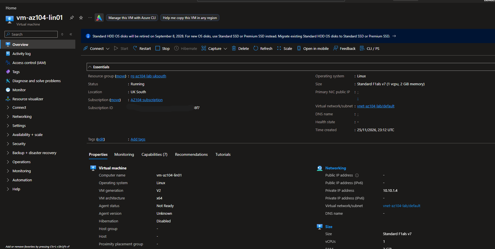

**Observation**

The VM was Running in UK South, size `Standard F1als v7`, in `vnet-az104-lab/default`. It had private IP `10.10.1.4` and no public IP. The agent status showed Not Ready, and I did not look into why.

---

<a id="step-2"></a>

### Step 2 - Add the VM's network interface to the ASG

I checked the application security group `asg-mgmt-vms` before and after adding the VM's network interface to it.

**Screenshot**

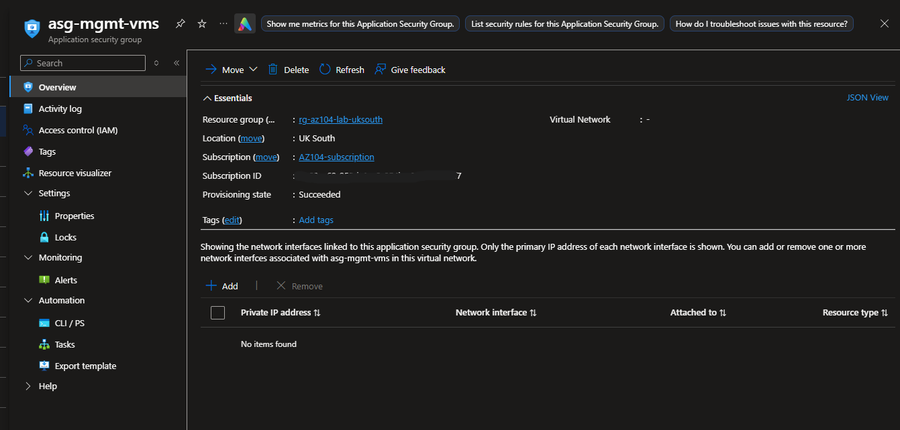

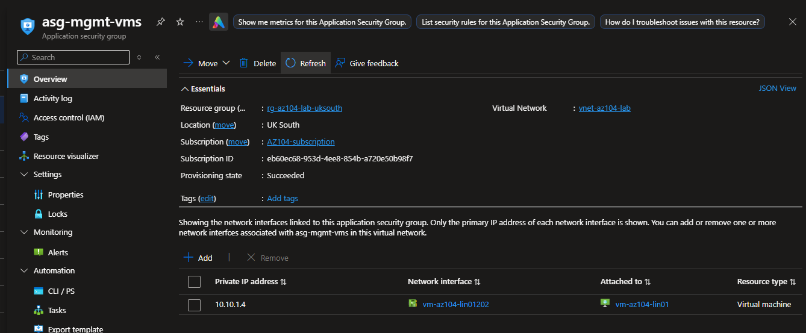

**Why This Matters**

An application security group lets me group network interfaces and use the group in a rule instead of IP addresses. My rule uses Destination Any, so the ASG does not affect it in this lab.

---

<a id="step-3"></a>

### Step 3 - Review the private DNS zone

I opened the private DNS zone `az104lab.internal` in the same resource group.

**Screenshot**

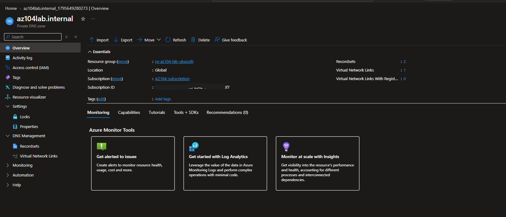

**Observation**

The zone shows 2 record sets and 1 virtual network link. It shows 0 links with registration, which fits auto-registration being disabled on the link.

---

<a id="step-4"></a>

### Step 4 - Check the app01 record and VNet link

I checked that the zone holds an A record called `app01` pointing to `10.10.1.4`, and that the zone is linked to `vnet-az104-lab`.

**Screenshot**

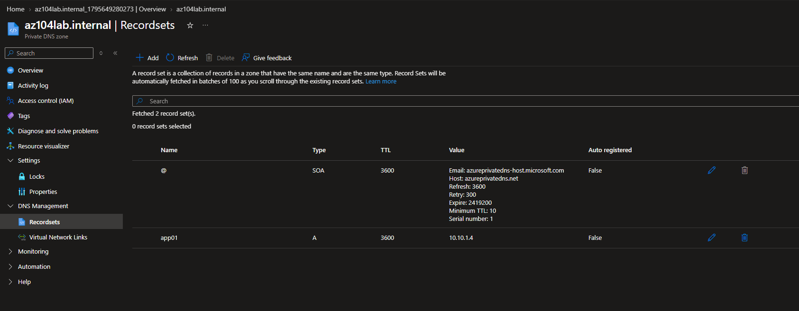

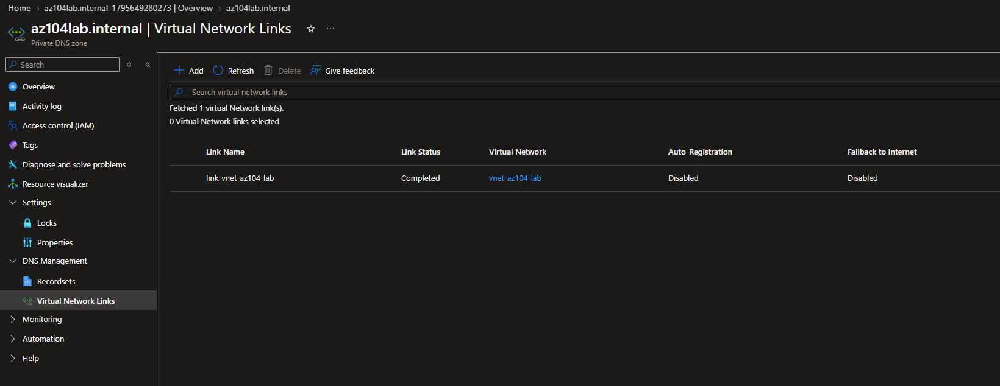

**Key Detail**

The `app01` record has a TTL of 3600 and Auto registered is False. The link `link-vnet-az104-lab` shows Completed, with auto-registration and fallback to internet both Disabled.

---

<a id="step-5"></a>

### Step 5 - Run IP flow verify for the first time

In Network Watcher I ran IP flow verify for inbound TCP traffic to `10.10.1.4` on local port 80, with the remote port set to `*`.

**Screenshot**

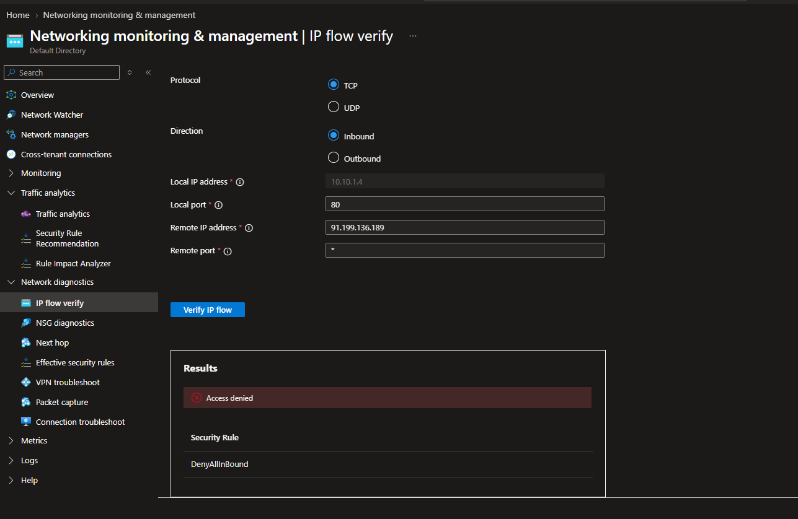

**Result**

The result was Access denied, matched by `DenyAllInBound`. The remote IP was not the source address in my rule, so this run did not test the rule itself.

---

<a id="step-6"></a>

### Step 6 - Check the ASG and effective security rules

I checked that the VM's network interface belongs to `asg-mgmt-vms`. Then I opened Effective security rules for that interface.

**Screenshot**

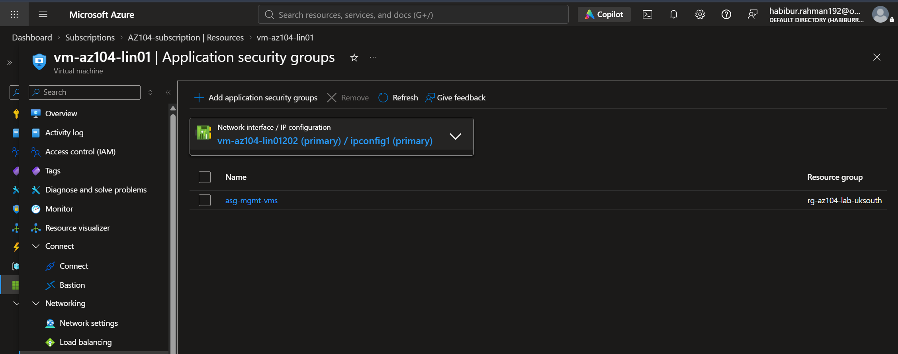

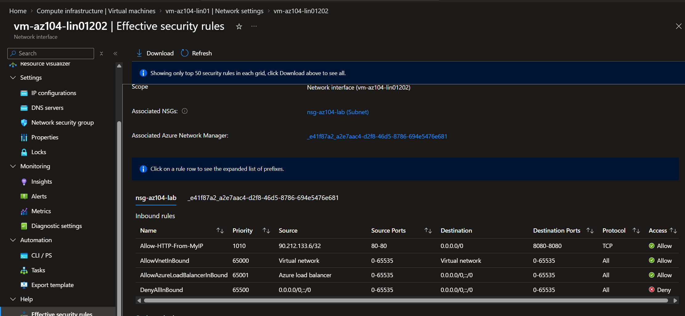

**Key Detail**

`nsg-az104-lab` applies through the subnet, and `Allow-HTTP-From-MyIP` at priority 1010 sits above `DenyAllInBound` at 65500. The same row shows source ports 80-80 and destination ports 8080-8080, which I did not notice at the time.

---

<a id="step-7"></a>

### Step 7 - Run NSG diagnostics

I ran NSG diagnostics in Network Watcher for `vm-az104-lin01`, using inbound TCP from my public IP to `10.10.1.4` on port 80.

**Screenshot**

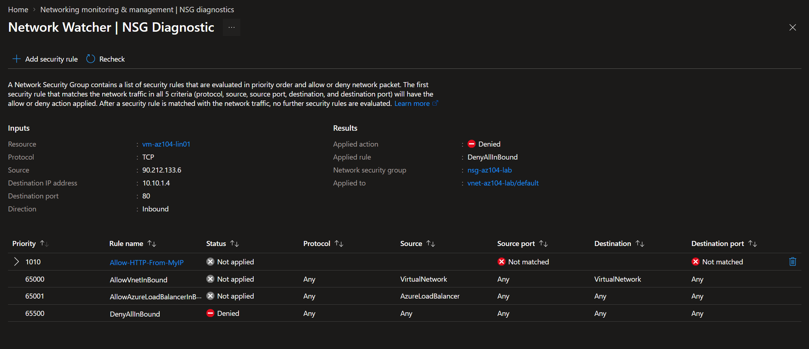

**Why This Matters**

The page explains that a rule only applies when all five criteria match: protocol, source, source port, destination and destination port. It marked `Allow-HTTP-From-MyIP` as Not applied, with source port and destination port both Not matched, so `DenyAllInBound` in `nsg-az104-lab` decided the result.

---

<a id="step-8"></a>

### Step 8 - Read the rule back

I opened `Allow-HTTP-From-MyIP` in `nsg-az104-lab` and read each field back one at a time.

**Screenshot**

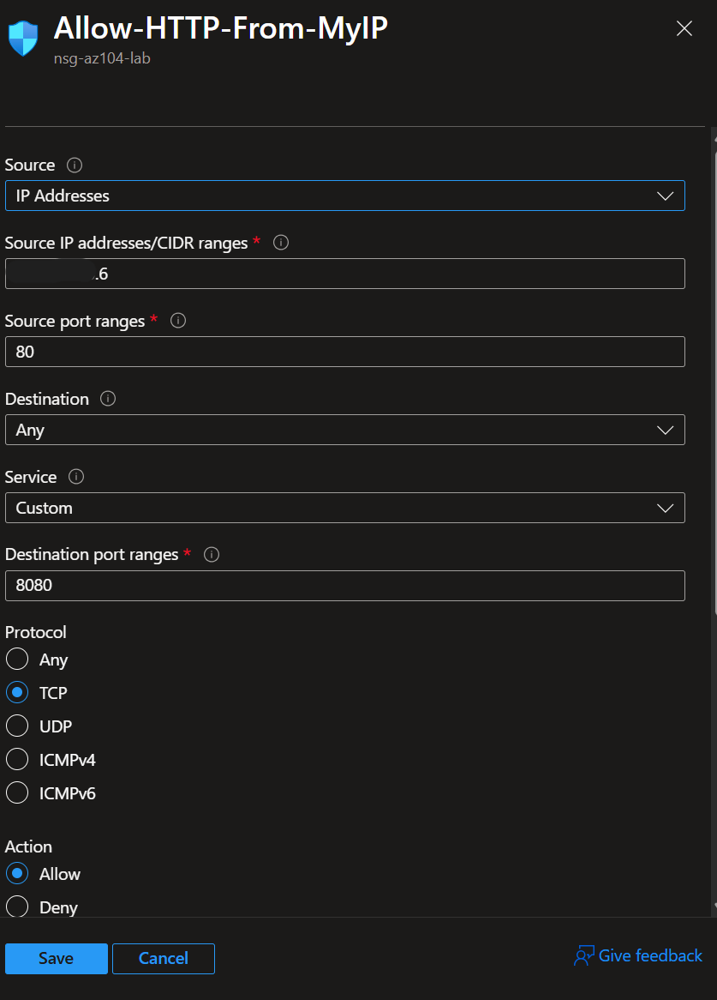

**Result**

The destination port range was 8080, not 80, so traffic to port 80 could never match. The source port range was also set to 80 instead of Any.

---

<a id="step-9"></a>

### Step 9 - Fix the destination port and retest

I corrected the destination port to 80, and the rule now shows Service as HTTP. I then reran IP flow verify for inbound traffic to `10.10.1.4` on local port 80, with remote port 80.

**Screenshot**

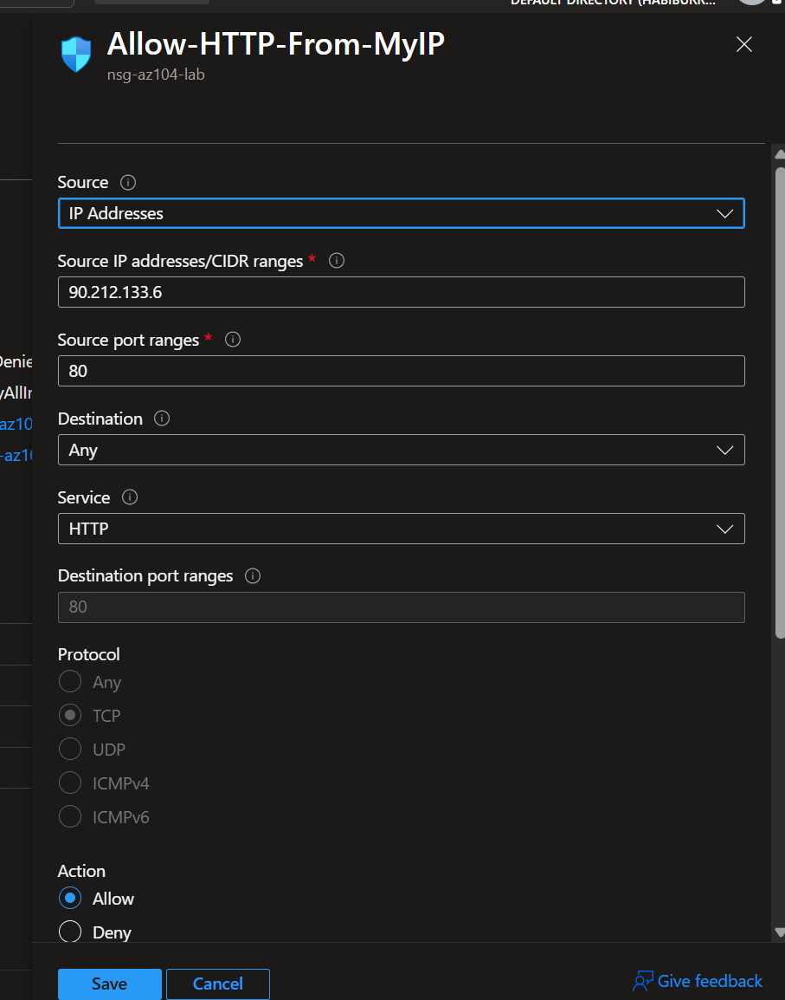

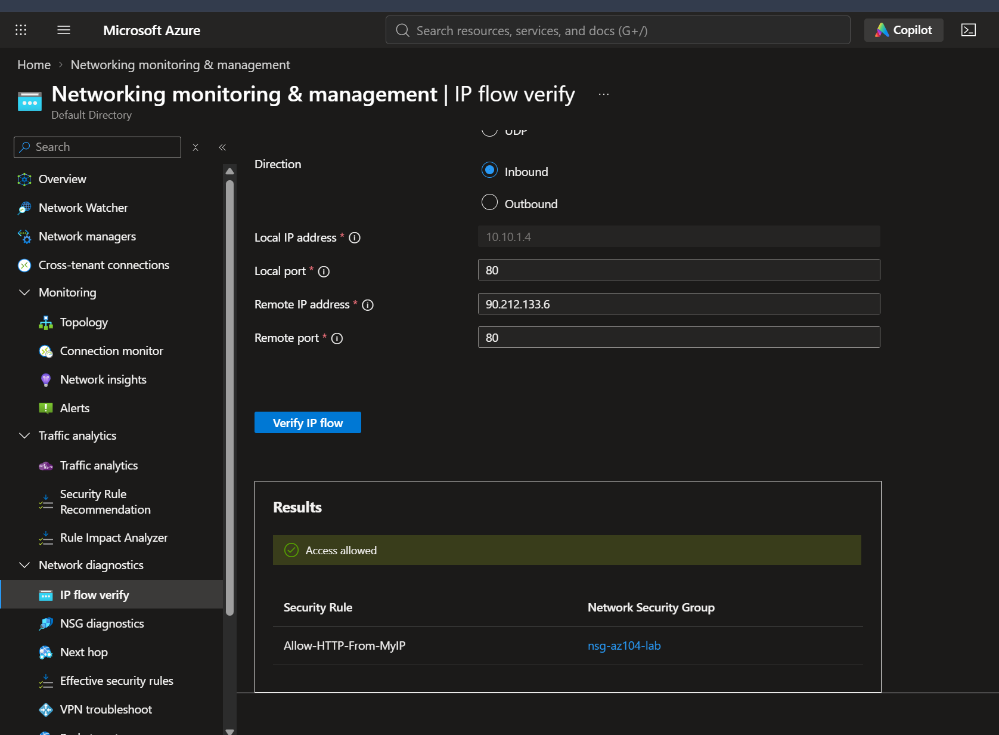

**Result**

IP flow verify returned Access allowed, matched by `Allow-HTTP-From-MyIP` in `nsg-az104-lab`. The rule's source port range is still 80 and the test used remote port 80, so this only proves a match for that test. Real clients usually connect from a random source port, so a real web rule would normally use Any, and I have not tested that.

---

<a id="step-10"></a>

### Step 10 - Test private DNS from the VM

I used Run command on `vm-az104-lin01` to run a shell script inside the VM. The script looked up the private DNS name.

```bash
nslookup app01.az104lab.internal
```

**Screenshot**

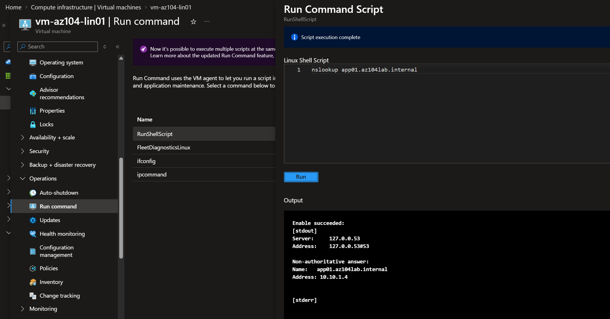

**Result**

The VM resolved `app01.az104lab.internal` to `10.10.1.4`, which matches the A record. The server shown is `127.0.0.53`, the VM's local resolver, and the answer is marked non-authoritative.

---

<a id="step-11"></a>

### Step 11 - Query a DNS server from Cloud Shell

From Azure Cloud Shell I looked up `www.az104-lab.example` and told `nslookup` to ask the server at `13.107.236.6`. This ran in Cloud Shell, not on the VM.

```bash
nslookup www.az104-lab.example 13.107.236.6
```

**Screenshot**

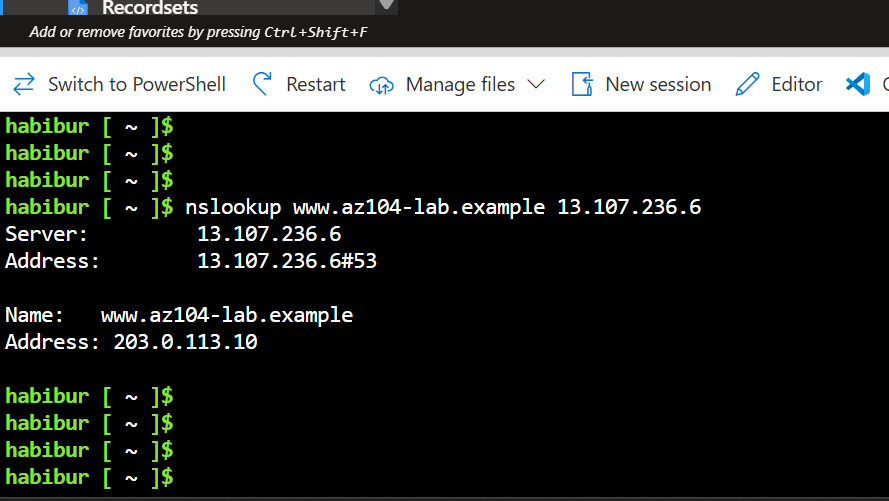

**Observation**

The server answered with `203.0.113.10`, an address range reserved for documentation, so I treated it as a test record. The screenshot does not show which zone holds it, and it does not prove public DNS delegation.

---

<a id="challenges-during-the-lab"></a>

## Challenges During the Lab

- IP flow verify returned `DenyAllInBound` even though `Allow-HTTP-From-MyIP` existed, sat above the deny rule at priority 1010 and appeared in the effective security rules.
- The subnet association, the NIC, the source address, the destination and the priority all checked out. The effective rules row showed destination port 8080, but I read past it.
- NSG diagnostics marked the ports as Not matched, and reading the rule back showed 8080 instead of 80.
- My first denied test used a remote IP that was not the rule's source, so it did not test the rule.
- The rule's source port range is still 80. I have not retested with Any, so the Access allowed result is not proof of normal client traffic.
- I did not use the ASG in a rule, and I did not make an end-to-end HTTP request to a web server.
- The VM ended up in the `default` subnet instead of `snet-management`, which the original lab instructions specified.

The main lesson was that reading each setting back is faster than assuming it is right.

<a id="key-takeaways"></a>

## Key Takeaways

This lab showed me how small a networking fault can be, and how easy it is to miss when I trust what I think I set.

The biggest lessons I took away were:

- An NSG rule must match on every criterion. One wrong value lets `DenyAllInBound` win, whatever the priority.
- Effective security rules show what is applied to the NIC, but I still have to read every column.
- NSG diagnostics shows which criteria failed. IP flow verify only names the rule that decided.
- A passing test only proves the conditions it used. Mine used remote port 80, which a normal client would not.
- An application security group only matters if a rule uses it. Mine used Destination Any.
- Once the private DNS zone was linked to the VNet, the VM resolved `app01` to `10.10.1.4`.
- `nslookup` can be pointed at a specific DNS server by adding its address to the command.

<a id="skills-practiced"></a>

## Skills Practiced

<a id="networking"></a>

### Networking

- Editing NSG inbound rules
- Understanding rule priority and the default rules
- Working with an NSG applied at subnet level
- Adding a NIC to an application security group
- Reading effective security rules for a network interface

<a id="troubleshooting"></a>

### Troubleshooting

- Using Network Watcher IP flow verify
- Using Network Watcher NSG diagnostics
- Checking a rule field by field
- Retesting after one change
- Stating what a test does and does not prove

<a id="dns"></a>

### DNS

- Checking a private DNS zone, an A record and a virtual network link
- Testing name resolution with `nslookup` from a VM and from Cloud Shell

<a id="virtual-machines"></a>

### Virtual Machines

- Reading VM status, size and network details
- Running a script with Run command
